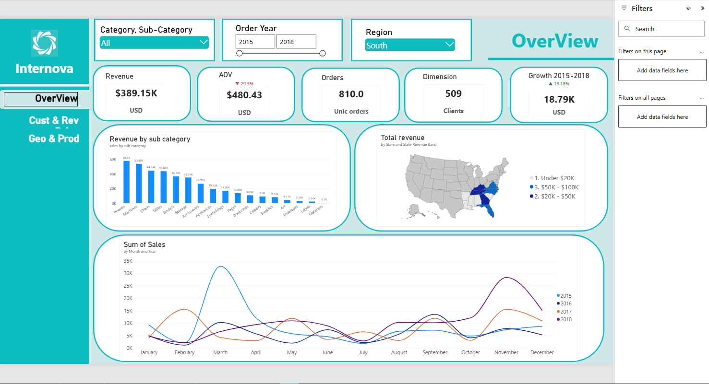
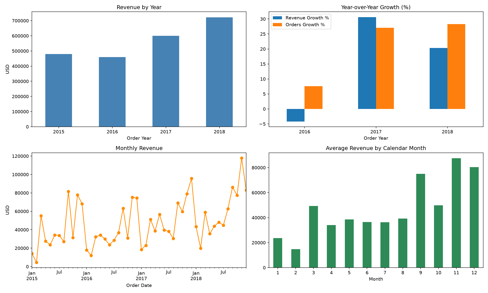
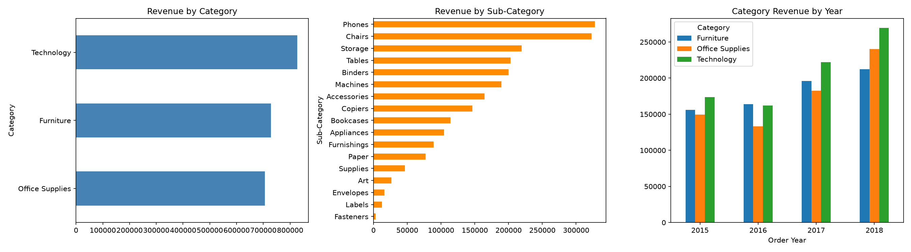
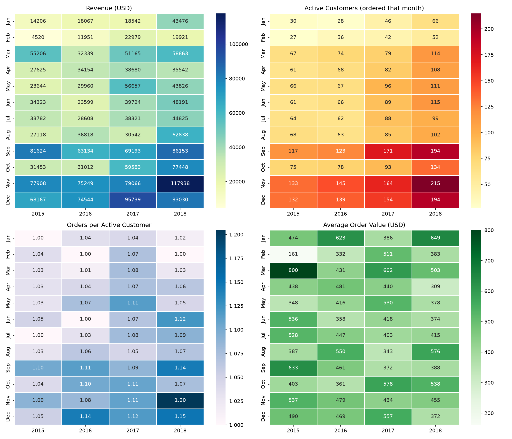
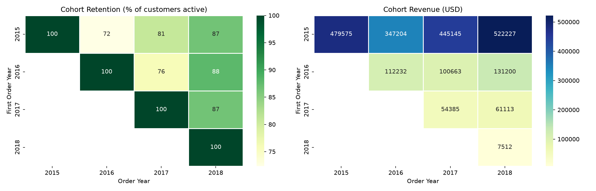
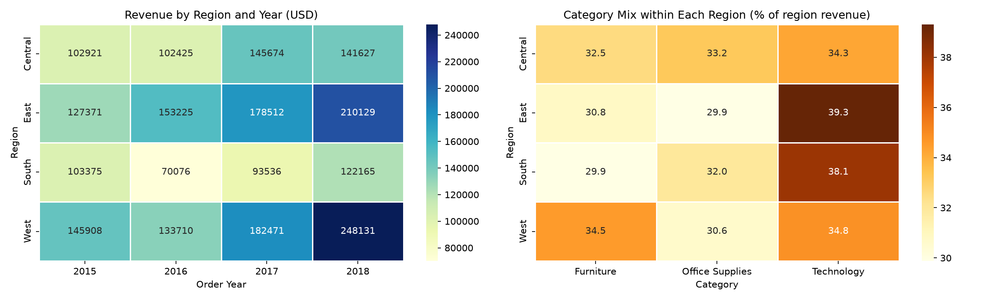
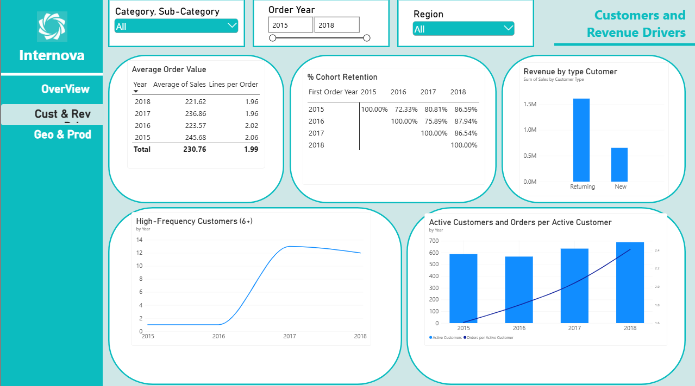
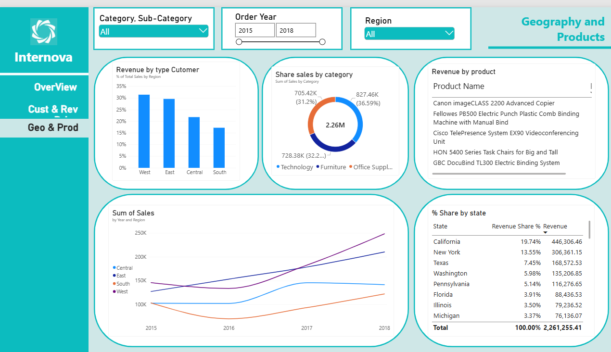

# 📊 Superstore Sales Data Analysis


> An end-to-end data analytics project: data cleaning, exploratory analysis, SQL analysis, an interactive Power BI dashboard, and a business report with actionable recommendations.

**Internova Data Analytics Virtual Internship** · Retail sales 2015-2018 · 9,799 records · $2.26M in revenue

<!-- IMAGE: cover. Add a screenshot of your dashboard overview page here -->


---

## 📑 Table of Contents

1. [Purpose](#1--purpose)
2. [Dataset](#2--dataset)
3. [Tools and Skills](#3--tools-and-skills)
4. [Process](#4--process)
5. [Key Metrics](#5--key-metrics)
6. [Insights and Recommendations](#6--insights-and-recommendations)
7. [Dashboard Presentation](#7--dashboard-presentation)
8. [Limitations](#8--limitations)
9. [Repository Structure](#9--repository-structure)
10. [How to Run](#10--how-to-run)
11. [Final Report](#11--final-report)
12. [Author](#12--author)

---

## 1. 🎯 Purpose

A retail superstore wants to understand how its sales performed between 2015 and 2018 and where to focus next. This project answers five business questions:

1. How has revenue evolved, and is the growth healthy?
2. When do sales peak and drop during the year?
3. Which products, regions, and states generate the most revenue?
4. Who are the customers, and what keeps revenue high?
5. Which actions could improve results?

**Deliverables:** clean dataset, analysis notebook, SQL queries, interactive Power BI dashboard, final report, and this documentation.

---

## 2. 🗂️ Dataset

| Item | Detail |
|---|---|
| Source | Superstore sales dataset provided by the Internova virtual internship |
| Records | 9,800 raw, **9,799** after cleaning |
| Columns | 18 original + 6 derived |
| Period | 3 January 2015 to 30 December 2018 |
| Granularity | One row is one product line within an order |
| Geography | United States: 4 regions, 49 states (including the District of Columbia) |
| Products | 3 categories, 17 sub-categories, 1,861 products |
| Measure | `Sales` (revenue in USD). No profit, cost, quantity, or discount columns |

**Main columns:** Order ID, Order Date, Ship Date, Ship Mode, Customer ID, Segment, Region, State, City, Postal Code, Category, Sub-Category, Product Name, Sales.

**Derived columns:** Shipping Days, Order Year, Order Month, Order Month Name, Order Quarter, Order Weekday.

---

## 3. 🛠️ Tools and Skills

### Tools

| Tool | Used for |
|---|---|
| **Python** (pandas, NumPy) | Cleaning, transformation, and exploratory analysis |
| **Matplotlib / Seaborn** | Charts and heatmaps (time trends, cohorts, geography) |
| **Jupyter Notebook** | Documenting each decision step by step |
| **SQL (SQLite)** | Business questions with aggregations, CTEs, and window functions |
| **Power BI + DAX** | Interactive dashboard and measures |
| **Git / GitHub** | Version control and publishing |
| **Claude (AI assistant)** | Methodology review, number checking, and documentation drafts |

### Skills demonstrated

- **Data cleaning:** data types, missing values, duplicates, consistency checks, and documented assumptions
- **Exploratory data analysis:** trends, seasonality, Pareto analysis, cohort retention, and customer frequency
- **SQL:** `GROUP BY`, conditional aggregation (`CASE WHEN`), CTEs, window functions (`LAG`, `SUM() OVER`, `NTILE`)
- **Data visualization and dashboard design:** KPI cards, maps, heatmaps, and drill-down
- **DAX:** year-over-year growth, CAGR, AOV, retention, and conditional indicators (▲ / ▼)
- **Business analysis:** turning findings into recommendations, and stating limitations honestly
- **Communication:** notebook documentation, final report, and README
- **AI-assisted analysis:** using an AI assistant to review methodology and catch errors, while validating every result against the data (pandas and SQL results cross-checked)

> **A note on AI use:** Claude was used as an assistant for reviewing the approach, checking numbers, and drafting documentation. The analysis, decisions, and conclusions were made and validated by the author.

---

## 4. 🔄 Process

### 4.1 Understand the dataset
Built a data dictionary (column meaning, data type, role) and checked the structure: 9,800 rows and 18 columns.

### 4.2 Clean the data

| Step | Issue found | Action taken | Result |
|---|---|---|---|
| Data types | `Order Date` and `Ship Date` loaded as text; `Postal Code` as a number | Converted dates to datetime (day-first) and Postal Code to text | Correct data types |
| Missing values | 11 records (0.11%) without Postal Code, all in Burlington, VT | Filled with `05401` as a documented assumption (no other Burlington record had a code) | 0 missing values |
| Duplicates | 1 record identical to another except `Row ID` | Removed. Impact: $281.37 (0.0124% of revenue) | 9,800 to 9,799 records |
| Categorical values | Checked typos, capitalization, whitespace | None found | No changes needed |
| Date consistency | Checked date order, ranges, shipping times | No Ship Date before Order Date; shipping 0 to 7 days, consistent with each ship mode | No changes needed |

### 4.3 Exploratory data analysis
Overall metrics, time trends, product performance, customer behavior (frequency heatmaps and cohort retention), a test of whether price changes explained the growth, and geography (region, state, city).

<!-- IMAGES: add the charts saved from the notebook -->
| Time trends | Products |
|---|---|
|  |  |

| Customer behavior | Cohorts |
|---|---|
|  |  |



### 4.4 SQL analysis
The clean dataset was loaded into SQLite (table `sales`) and analyzed with SQL: KPIs, yearly growth with `LAG`, seasonality, sub-category Pareto with cumulative share, state and city concentration, cohort retention, customer deciles with `NTILE`, and shipping performance. Results were **validated against the pandas results**. All queries are in [`sql/queries.sql`](sql/queries.sql).

```sql
-- Example: yearly revenue, AOV and growth
WITH yearly AS (
    SELECT order_year, SUM(sales) AS revenue, COUNT(DISTINCT order_id) AS orders
    FROM sales
    GROUP BY order_year
)
SELECT order_year,
       ROUND(revenue, 2)                                         AS revenue,
       ROUND(revenue / orders, 2)                                AS aov,
       ROUND(100.0 * (revenue / LAG(revenue) OVER (ORDER BY order_year) - 1), 2) AS growth_pct
FROM yearly;
```

### 4.5 Dashboard
An interactive Power BI dashboard with filters by year, category, and location. See [Dashboard Presentation](#7--dashboard-presentation).

### 4.6 Insights and report
Six insights with recommendations, summarized below and detailed in the [final report](#11--final-report).

---

## 5. 📈 Key Metrics

| Metric | Value |
|---|---|
| Total revenue | **$2,261,255.41** |
| Unique orders | **4,922** |
| Unique customers | **793** |
| Average order value (AOV) | **$459.42** |
| Revenue growth 2015 to 2018 | **+50.6%** (CAGR 14.61%) |
| Median vs mean sales per line | $54.48 vs $230.76 (right-skewed) |
| Average shipping time | 3.96 days |

| Year | Revenue | Orders | AOV | Growth |
|---|---|---|---|---|
| 2015 | $479,574.84 | 947 | $506.41 | - |
| 2016 | $459,436.01 | 1,019 | $450.87 | -4.20% |
| 2017 | $600,192.55 | 1,295 | $463.47 | +30.64% |
| 2018 | $722,052.02 | 1,661 | $434.71 | +20.30% |

---

## 6. 💡 Insights and Recommendations

### 1) Revenue grows, but the average order is getting smaller
- Revenue +50.6% and orders +75.4%, while **AOV fell 14.2%** ($506.41 to $434.71).
- Lines per order fell from 2.06 to 1.96, and average sales per line fell 9.8%, while the median stayed stable. The average fell because of **fewer very large sales** (Machines -29.8%).
- **Recommendation:** increase basket size with bundles and cross-selling, and track high-ticket sales separately.

### 2) Sales are highly seasonal
- **September, November, and December** generate about **43%** of average annual revenue. Q4 alone is 37% to 39% every year.
- January and February are the weakest months.
- **Recommendation:** plan inventory, staffing, and promotions ahead of September to December, and use low months for targeted campaigns.

### 3) Growth comes from order frequency and loyal customers, not more customers
- Active customers +17.1%, but **orders per active customer +49.7%** (1.61 to 2.41).
- Customers with 6 or more orders in a year: 1 (2015), 1 (2016), 13 (2017), 12 (2018). Earlier cohorts stayed above 80% active in 2018.
- **Recommendation:** protect repeat buyers with loyalty or reorder incentives, and reactivate inactive customers before the peak season.

### 4) Revenue depends on a few markets
- **California (19.7%) and New York (13.6%)** generate 33.3% of revenue. 16 of 49 states generate 80%.
- New York City is the top city ($252,463). The West leads by region, but **California is 62.8% of West revenue**.
- California leads through order volume (1,002 orders vs 547), not order size (AOV $445 vs $560).
- **Recommendation:** study California and New York City as markets, adjust for population, and track concentration as a risk.

### 5) The South is the weakest region
- Lowest share (17.2%) and slowest growth (**+18.2%** vs +70.1% in the West and +65.0% in the East). Its revenue fell 32.2% in 2016.
- Segment mix and shipping times are almost identical across regions, so they do not explain the gap.
- **Recommendation:** review the South market and set a growth target.

### 6) Product revenue is balanced by category but concentrated in a few sub-categories and products
- Technology 36.6%, Furniture 32.2%, Office Supplies 31.2%. **Phones and Chairs alone are 28.8%**, and the top 10% of products generate 59.1% of revenue.
- **Machines and Copiers: 14.8% of revenue from only 1.9% of order lines**, a volatile source of revenue.
- Furniture is losing share (32.6% to 29.4%).
- **Recommendation:** protect leading sub-categories, treat Machines and Copiers as high-value but volatile, and review the Furniture slowdown.

---

## 7. 🖥️ Dashboard Presentation

An interactive Power BI dashboard with slicers for order year, category, and location.

**Page 1: Overview.** KPI cards (revenue, unique orders, customers, AOV, 2015-2018 growth with ▲ indicator), revenue by sub-category, revenue by state, and monthly revenue by year.

<!-- IMAGE: Page 1 screenshot -->


**Page 2: Customers and revenue drivers.** Active customers, orders per customer, cohort retention, and new vs returning revenue.

<!-- IMAGE: Page 2 screenshot -->


**Page 3: Geography and products.** Regions, top states and cities, and category mix.

<!-- IMAGE: Page 3 screenshot -->


**DAX measures used:** total revenue, unique orders (`DISTINCTCOUNT`), AOV, year-over-year growth, fixed-period growth with CAGR, growth indicator (▲ / ▼ with conditional color), and cohort retention.

```dax
AOV = DIVIDE([Total Revenue], [Total Orders])

Growth 2015-2018 % =
DIVIDE([Revenue 2018] - [Revenue 2015], [Revenue 2015])
```

<!-- OPTIONAL: add a link to the published dashboard or a short demo GIF -->
<!-- [View the live dashboard](PASTE-LINK-HERE) -->

---

## 8. ⚠️ Limitations

- The dataset has **no profit, cost, quantity, or discount** columns. Rankings are by revenue, not profitability, and price effects cannot be separated from quantity or discounts.
- Findings describe **what happened, not why**. Explanations such as promotions or campaigns are hypotheses.
- Customers are counted by delivery location, and customers ship to several regions, so customer counts by region are not unique customers.
- Customers first seen in 2015 may have bought before the dataset starts.
- Revenue by state is not adjusted for population or market size.
- The 11 missing postal codes were filled with an assumed value, and one duplicate record was removed. Neither affects the conclusions.

---

## 9. 📁 Repository Structure

```
superstore-sales-analysis/
├── README.md
├── data/
│   ├── superstore_raw.csv
│   └── superstore_clean.csv
├── notebooks/
│   └── superstore_analysis.ipynb
├── sql/
│   └── queries.sql
├── dashboard/
│   └── superstore_dashboard.pbix
├── images/
│   ├── dashboard_overview.png
│   ├── dashboard_customers.png
│   ├── dashboard_geography.png
│   ├── eda_time_trends.png
│   ├── eda_products.png
│   ├── eda_customer_heatmaps.png
│   ├── eda_cohorts.png
│   └── eda_geography.png
└── report/
    └── Superstore_Final_Report.pdf
```

---

## 10. ▶️ How to Run

```bash
# 1. Clone the repository
git clone https://github.com/YOUR-USERNAME/superstore-sales-analysis.git
cd superstore-sales-analysis

# 2. Install dependencies
pip install pandas numpy matplotlib seaborn plotly jupyter

# 3. Open the notebook
jupyter notebook notebooks/superstore_analysis.ipynb
```

- The SQL step uses SQLite, which is included with Python (no installation needed).
- Open `dashboard/superstore_dashboard.pbix` with **Power BI Desktop**.

---

## 11. 📄 Final Report

The full report (executive summary, method, metrics, six insights with recommendations, and limitations) is in [`report/Superstore_Final_Report.pdf`](report/Superstore_Final_Report.pdf).

---

## 12. 👤 Author

**Jair Alejandro Forero Rodríguez**
Data analyst in training

- LinkedIn: [PASTE-LINK-HERE](https://www.linkedin.com/in/YOUR-PROFILE)
- GitHub: [YOUR-USERNAME](https://github.com/YOUR-USERNAME)

*Project completed as part of the Internova Data Analytics Virtual Internship.*
